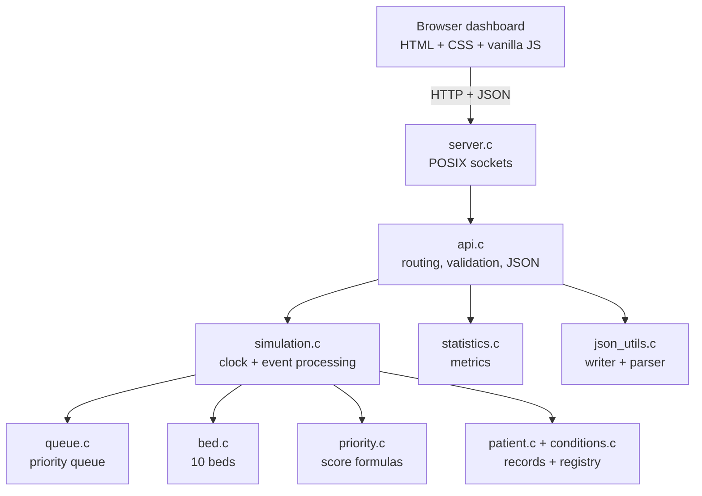
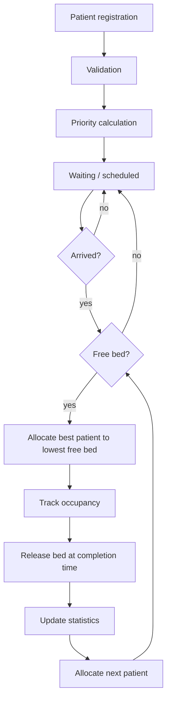

# Hospital Priority Queue & Bed Allocation Scheduler

An Operating Systems project written in C. A simulated hospital with **10 beds** receives patients, computes a priority score for each, keeps them in a priority queue, allocates beds, releases them when the simulated occupancy ends, and reports scheduling metrics. A small HTTP server written in C serves an embedded browser dashboard.

> **Academic simulation only.** The severity scores, age adjustments and occupancy durations are illustrative demonstration parameters. They are not medical triage standards and must never be used for real clinical decisions.

## 1. Problem statement

A resource (beds) is limited and demand (patients) is concurrent. Which patient gets the next free bed? This is the classic CPU-scheduling question with beds as the "CPU" and patients as "processes".

## 2. Objectives

- Implement priority scheduling with FCFS tie-breaking.
- Model resource allocation and release on a deterministic simulated clock.
- Measure waiting, turnaround and response time.
- Show starvation and priority aging.

## 3. Operating Systems concepts demonstrated

| Concept | Where |
|---|---|
| Priority scheduling | `queue.c`, `priority.c` |
| Priority queue | `build_waiting_queue()`, `get_next_waiting_patient()` |
| FCFS tie-breaking | arrival time, then registration sequence |
| Non-preemptive scheduling | an occupied bed is never taken away |
| Resource allocation / release | `bed.c` |
| Event-driven simulation | `advance_simulation()` in `simulation.c` |
| Scheduling metrics | `statistics.c` |
| Starvation and aging | optional priority aging |

Bed allocation is a *modeled application* of scheduling and resource-allocation ideas, not a literal CPU scheduler.

## 4. Features

- Exactly 10 beds; lowest-numbered free bed is used first.
- Predefined condition registry; server-side validation of every field.
- Priority is always computed by the server; a client-supplied priority is rejected.
- Future arrivals wait in a `Scheduled` state until their arrival minute.
- Deterministic clock (integer minutes from midnight, starts at 09:00); events inside a long advance are processed in chronological order.
- Optional priority aging (off by default).
- 17-patient demo scenario, reset, notifications, statistics and simple charts.
- Fully offline: HTML/CSS/JS are embedded in the executable.

## 5. Architecture



### Modules

| File | Responsibility |
|---|---|
| `config.h` | every tunable constant (beds, limits, age bands, aging interval) |
| `conditions.c` | condition registry and eligibility rules |
| `patient.c` | `Patient` record, lifecycle states, input validation, `HH:MM` helpers |
| `priority.c` | `calculate_priority()`, `calculate_effective_priority()` |
| `queue.c` | ordering comparator, next-patient selection, sorted waiting queue |
| `bed.c` | `Bed` struct, assign/release with safety checks |
| `simulation.c` | whole state, register, advance, reset, start/pause/resume, demo |
| `statistics.c` | waiting/turnaround/response, averages, utilization |
| `json_utils.c` | JSON writer and a deliberately small flat-object parser |
| `api.c` | endpoints; independent of sockets so it is unit-testable |
| `server.c` | HTTP/1.1 server, request framing, auto-tick timer |
| `main.c` | argument parsing, startup |

## 6. Priority score

```
Priority Score = Disease Severity + Age Adjustment
Age Adjustment = +2 if age < 5,  +0 if 5 <= age <= 64,  +2 if age >= 65
```

Higher is served first. Gender is never used. Example: age 3 / severity 1 → 3; age 40 / severity 4 → 4; age 70 / severity 3 → 5 (order: C, B, A).

## 7. Queue ordering and FCFS

1. Higher (effective) priority first.
2. Equal priority: earlier arrival time first.
3. Still equal: lower registration sequence first (`PAT-0001` before `PAT-0002`).

Only patients that are `Waiting` and whose arrival time ≤ now are eligible.

## 8. Bed allocation algorithm

Non-preemptive: a patient keeps the bed until the modeled occupancy finishes, even if a higher-priority patient arrives (the *non-preemptive* variant of priority scheduling; the preemptive variant would evict the occupant).

```
allocate(t):
    while there is a free bed and an eligible waiting patient:
        bed     = lowest-numbered free bed
        patient = best waiting patient by the ordering rules
        bed.start = t;  bed.end = t + condition.duration
        patient.status = IN_BED
```

## 9. Simulation clock and event policy

The clock never reads the computer's clock. `advance(minutes)`:

```
target = now + minutes            (rejected if <= 0, > 480, or past 23:59)
settle(now)
while now < target:
    t = earliest of { bed completion, scheduled arrival } in (now, target], else target
    now = t
    1. release every bed with end <= t      (patients -> Completed)
    2. scheduled patients with arrival <= t -> Waiting
    3. allocate free beds by priority
```

Same-timestamp policy: **completions first, then arrivals, then allocation**, so a patient arriving the minute a bed frees can use that bed. Simultaneous completions are processed in bed-number order. The dashboard's polling only reads state, so it never moves the clock.

**Start / Pause / Resume:** `Running` makes the server advance one simulated minute every `--tick-seconds` real seconds (default 2). `Pause` stops it. The `+N min` buttons always work, in any state.



## 10. Metric definitions

| Metric | Formula |
|---|---|
| Waiting time | occupancy start − arrival (while waiting: now − arrival) |
| Turnaround time | completion − arrival |
| Response time | first bed assignment − arrival (equals waiting time here, because the model is non-preemptive) |
| Bed utilization | occupied beds / total beds × 100 |
| Averages | over **completed** patients only; shown as `N/A` when none |

## 11. Starvation and aging

In plain priority scheduling a low-priority patient can wait forever while higher-priority patients keep arriving. With aging enabled (checkbox on the *Waiting Queue* page, **off by default**):

```
Effective Priority = Original Priority + floor(WaitingTime / 30)
```

The original score is never modified; the queue uses the effective value. This is a scheduling demonstration, not a triage rule.

## 12. API reference

All responses: `{"success":true,"message":"...","data":...}` or `{"success":false,"error":"..."}`.

| Method & path | Purpose |
|---|---|
| `GET /` | dashboard (also `/styles.css`, `/app.js`) |
| `GET /api/state` | clock, status, counts, statistics, recent events |
| `GET /api/patients` | all patient records (with `queue_position`) |
| `GET /api/beds` | the 10 beds |
| `GET /api/statistics` | metrics |
| `GET /api/conditions` | condition registry |
| `POST /api/patients` | register: `name, age, gender("male"/"female"/"other"), condition_id, arrival_time("HH:MM"), clinical_context_confirmed?` — unknown fields (e.g. `priority`) → 400 |
| `POST /api/simulation/start` `/pause` `/resume` | status control (409 if invalid in the current status) |
| `POST /api/simulation/advance` | `{"minutes":N}`, 1–480, within the day |
| `POST /api/simulation/reset` | back to 09:00, no patients, 10 free beds |
| `POST /api/demo/load` | reset, then load the 17-patient scenario |
| `POST /api/patients/clear` | remove patient records; 409 while beds are occupied |
| `POST /api/settings/aging` | `{"enabled":true/false}` (addition to the required list) |

Status codes: 200, 201, 400 (validation / malformed JSON), 404, 405, 409, 413, 431, 501.

## 13. Folder structure

```
hospital-scheduler/
  src/        C sources and headers
  web/        index.html, styles.css, app.js (embedded at build time)
  generated/  embedded_assets.h (generated by scripts/embed_assets.py)
  tests/      test_priority, test_queue, test_beds, test_simulation,
              test_statistics, test_json, test_api
  scripts/    build.sh run.sh test.sh e2e.sh embed_assets.py
  Makefile  README.md  LICENSE  .gitignore
```

`embed_assets.py` runs only at build time. The running program is pure C.

## 14. Build, run, test

Needs `gcc`, `make`, `python3` (build-time asset embedding only). On Ubuntu:

```
sudo apt install build-essential python3 curl
```

```
make            # build/hospital_scheduler
make run        # build and start on http://127.0.0.1:8080
make test       # unit + API tests
./scripts/e2e.sh   # HTTP end-to-end test against the real server
make clean
```

Options: `./build/hospital_scheduler --port 9000 --tick-seconds 1` (`--tick-seconds 0` disables auto-advance). The server listens on `127.0.0.1` only and prints a clear error if the port is already in use.

## 15. Reproducible demo

1. `make run`, open <http://127.0.0.1:8080>.
2. Click **Load Demo** (09:00). 17 patients: 12 arrive at 09:00, 5 later.
   - Beds 1–10 fill in priority order: Ravi Kumar (7), Li Wei (6), Emily Chen (6), Anita Sharma (5), John Miller (4), then the priority-3 patients Sara, Omar, Maria in registration order, then Priya and Tom (2).
   - Neha Gupta and Karan Singh (priority 1) wait; Neha is first by FCFS.
   - Five future arrivals (09:10–10:00) have no bed.
3. Click **+15 min**: Maria Garcia (15 min) completes at exactly 09:15 (turnaround 15) and Fatima Noor (priority 4, arrived 09:10, waited 5 min) takes her bed.
4. Click **+5 min** until 09:20: Omar completes; Neha gets the bed (David Lee, priority 1, arrived 09:20, ranks behind her on FCFS).
5. Click **Start Simulation**, then **Pause**: the clock stops. Toggle **Priority aging** and watch *Effective* priority grow in the queue.
6. Click **Reset**: 09:00, all beds free, no patients.

## 16. Test results (as run)

`make test`: 7 suites, 517 checks, all passing (priority 26, queue 14, beds 53, simulation 277, statistics 24, JSON 26, API 97). `scripts/e2e.sh`: 22 checks, all passing, including requests whose headers and body arrive in separate pieces.

## 17. Known limitations

- State is in memory only; it is lost when the program stops (no persistence implemented).
- One hospital day (00:00–23:59); no midnight rollover.
- Single-threaded server, one request at a time.
- Patient names are limited to 80 bytes of UTF-8.
- Beds cannot be manually released or taken out of service.
- The frontend was syntax-checked and its element IDs cross-checked, and the served assets and API were exercised over HTTP, but the dashboard has **not** been exercised in a real browser session by the author of this code (no browser was available in the build environment). Please open it once and report anything odd.

## 18. Future enhancements

Preemptive variant, manual bed release, multiple wards, file persistence, a heap-based queue, per-minute utilization history.
